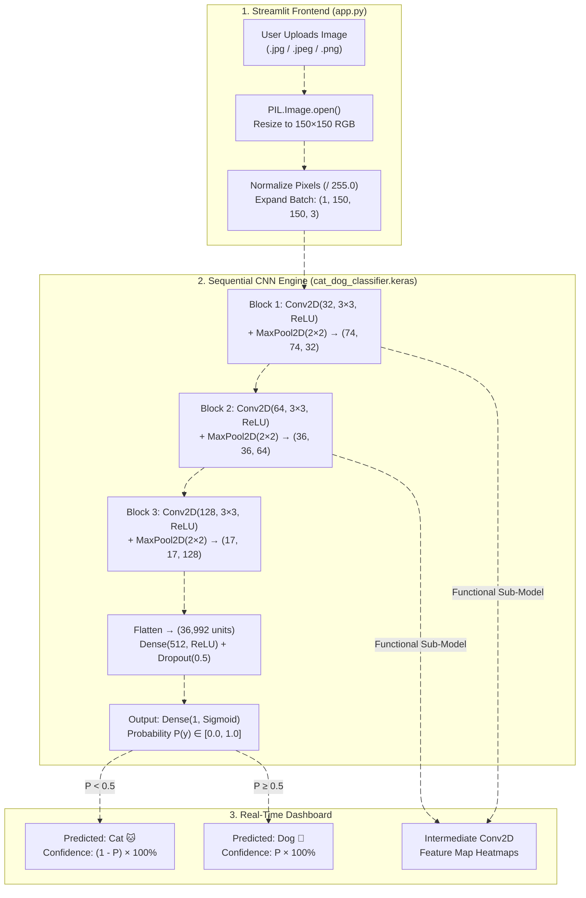

# 🐾 DL-003: Real-Time CNN Cat vs. Dog Classifier

**Live Streamlit Web App:** [https://cat-anddogimageclassification-tkpmybq9v5qrkbzla8dsts.streamlit.app/](https://cat-anddogimageclassification-tkpmybq9v5qrkbzla8dsts.streamlit.app/)  
**GitHub Repository:** [https://github.com/xploreshivam/cat-and_dog_image_classification](https://github.com/xploreshivam/cat-and_dog_image_classification)  
**Google Colab Notebook:** [https://colab.research.google.com/drive/11H\_BtjAKSg-czepEOvtQFP4BNg2Qnwvu](https://www.google.com/search?q=https://colab.research.google.com/drive/11H_BtjAKSg-czepEOvtQFP4BNg2Qnwvu)  
**Tech Stack:** Python, TensorFlow (`tensorflow-cpu`), Keras, Streamlit, Pillow (`PIL`), NumPy, Scikit-Learn, Matplotlib

## 🎓 Academic & Team Details

| Attribute | Details |
| :--- | :--- |
| **Institution** | Invertis University, Bareilly — Center for Skill and Entrepreneurship Development (CSED) |
| **Department & Program** | Department of Computer Science & Engineering — B.Tech (CSE), Semester V, Section E |
| **Project ID & Group ID** | `DL-003` \| `BTech_DL_041` (Program: `V E`) |
| **Project Mentor** | **Mr. Pradeep Singh** |
| **Team Leader** | **Shivam Chauhan** (`BCS2024016` \| Roll No.: `2410303464`) |

### 👥 Team Members & Role Credits (`BTech_DL_041`)

| Sr. No. | Student Name | Student ID | Roll No. | Role & Contribution |
| :---: | :--- | :---: | :---: | :--- |
| **1** | **Shivam Chauhan (T.L.)** | `BCS2024016` | `2410303464` | **Team Leader** — System Design, CNN Model Training & Streamlit Cloud Deployment |
| **2** | **Mohd Adnan** | `BCS2024007` | `2410303271` | Dataset Collection & Folder Setup |
| **3** | **Krish Gupta** | `BCS2024013` | `2410303234` | Image Format Validation & Cleaning |
| **4** | **Ginesh Singh** | `BCS2024020` | `2410303186` | Duplicate Image Check & Filtering |
| **5** | **Neil Bhardwaj** | `BCS2024030` | `2410303306` | Train, Validation & Test Data Splitting |
| **6** | **Hirdesh Kumar** | `BCS2024033` | `2410303209` | Image Resizing (`150×150`) & Pixel Normalization |
| **7** | **Mohit Babu** | `BCS2024034` | `2410303293` | Image Augmentation (Flip, Rotate & Zoom) |
| **8** | **Shivam Sharma** | `BCS2024035` | `2410303467` | CNN Layer Design (`Conv2D` & `MaxPooling2D`) |
| **9** | **Ramjeet Yadav** | `BCS2024039` | `2410303385` | Model Comparison & Transfer Learning Setup |
| **10** | **Shaurya Kumar Yadav** | `BCS2024049` | `2410303452` | Model Training, Loss Tracking & Early Stopping |
| **11** | **Shivanshu Sharma** | `BCS2024056` | `2410303473` | Accuracy, Precision, Recall & Confusion Matrix |
| **12** | **Mohd Yameen** | `BCS2024066` | `2410303289` | Testing on Real-World & Varied Backgrounds |
| **13** | **Akhilesh Bhargav** | `BCS2024081` | `2410303048` | Live `Conv2D` Feature Map Visualization |
| **14** | **Siddharth Mishra** | `BCS2024087` | `2410303481` | Streamlit Web UI Layout & App Testing |

## 🔄 System Architecture & Flow Diagram



## 🖥️ Web Application UI & Screenshots (`app.py`)

**Live App Link:** [DL-003: Real-Time CNN Cat vs. Dog Classifier](https://cat-anddogimageclassification-tkpmybq9v5qrkbzla8dsts.streamlit.app/)

### Key UI Sections in the Final Streamlit App

1. **Sidebar (`Invertis University Bareilly`)**:
   * Displays project header: **`CSED | Project ID: DL-003 | Group: BTech_DL_041`**.
   * Includes custom model uploader (**`Upload your Trained .keras Model if you have if not try our`**) supporting `.keras` and `.h5` files up to `200MB`, while loading the pre-trained `cat_dog_classifier.keras` by default.
2. **Main Image Uploader (`DL-003: Real-Time CNN Cat vs. Dog Classifier`)**:
   * Drag-and-drop file uploader (**`Choose an image...`**) accepting `.jpg`, `.jpeg`, and `.png` pet photos.
3. **Real-Time Classification Results (`col1` & `col2`)**:
   * **Left Column**: Displays the uploaded pet image preview.
   * **Right Column (`Classification Results`)**:
     * Shows instant prediction banner: **`🐱 Predicted: CAT`** ($P < 0.5$) or **`🐶 Predicted: DOG`** ($P \ge 0.5$).
     * Displays **Prediction Confidence (%)** metric with a visual progress bar, **Raw Sigmoid Output** (`0.0000` to `1.0000`), and an expandable **`🔍 View Raw Confidence Breakdown`** panel.
4. **Live Convolutional Feature Maps (`Section 6`)**:
   * **`6. Live Convolutional Feature Maps & Dynamic Layer Architecture`** extracts and plots real-time activation heatmaps from intermediate `Conv2D` layers (`conv2d`, `conv2d_1`, `conv2d_2`) so users can see how the CNN detects edges, ears, and facial contours.

### 📸 UI Screenshots Gallery (Add Your Screenshots Here)

> **How to add images on GitHub:** Upload your screenshots inside an `assets/` or `screenshots/` folder in your repository (or drag-and-drop them directly while editing `Readme.md` on GitHub) and update the paths below:

| 1. Main Dashboard & Sidebar UI | 2. Cat 🐱 / Dog 🐶 Prediction & Confidence |
| :---: | :---: |
|  |  |
| *Main uploader with Invertis University (`BTech_DL_041`) sidebar & `.keras` model loader.* | *Side-by-side uploaded image, predicted class banner, confidence bar & raw Sigmoid score.* |

| 3. Raw Confidence Breakdown Expander | 4. Live `Conv2D` Feature Map Heatmaps |
| :---: | :---: |
|  |  |
| *Expandable class probability breakdown (`<0.5 = Cat` \| `≥0.5 = Dog`).* | *Real-time intermediate `Conv2D` layer activations extracted from the uploaded image.* |

## 🧠 CNN Model Architecture (`cat_dog_classifier.keras`)

| Layer | Configuration | Activation | Output Shape | Parameters | Simple Purpose |
| :--- | :--- | :---: | :---: | :---: | :--- |
| **Input** | RGB Image | — | `(1, 150, 150, 3)` | `0` | Accepts `150×150` RGB image scaled to `[0, 1]` |
| **`Conv2D` (Block 1)** | `32` filters (`3×3`) + `MaxPool2D(2×2)` | `ReLU` | `(1, 74, 74, 32)` | `896` | Detects basic edges and color boundaries |
| **`Conv2D_1` (Block 2)** | `64` filters (`3×3`) + `MaxPool2D(2×2)` | `ReLU` | `(1, 36, 36, 64)` | `18,496` | Captures fur textures and ear shapes |
| **`Conv2D_2` (Block 3)** | `128` filters (`3×3`) + `MaxPool2D(2×2)` | `ReLU` | `(1, 17, 17, 128)` | `73,856` | Identifies facial features (eyes, nose, snout) |
| **`Flatten`** | `17 × 17 × 128` | — | `(1, 36992)` | `0` | Converts 3D feature maps into a 1D vector |
| **`Dense` + `Dropout`** | `512` units + `Dropout(0.5)` | `ReLU` | `(1, 512)` | `18,940,416` | Combines features and prevents overfitting |
| **`Dense_1` (Output)** | `1` unit | `Sigmoid` | `(1, 1)` | `513` | Outputs `< 0.5` for **Cat 🐱** and `≥ 0.5` for **Dog 🐶** |

## 📊 Dataset & Model Performance

* **Dataset:** Kaggle Dogs vs. Cats Dataset (`25,000` labeled images)
* **Optimizer & Loss:** `Adam` optimizer with `Binary Crossentropy` loss
* **Training Accuracy:** **~92.4%**
* **Validation Accuracy:** **~88.7%**

## 🚀 How to Run Locally

```bash
# 1. Clone the repository
git clone https://github.com/xploreshivam/cat-and_dog_image_classification.git
cd cat-and_dog_image_classification

# 2. Install required packages
pip install -r requirements.txt

# 3. Start the Streamlit web app
streamlit run app.py
```