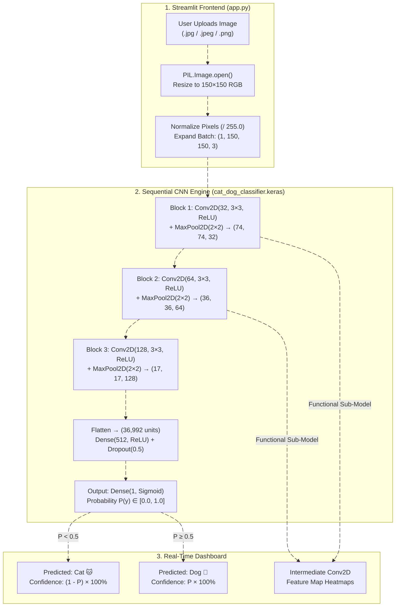

# Cat and Dog Image Classification Using Deep CNN (`DL-003`)

**Live Streamlit Web App:** [https://cat-anddogimageclassification-tkpmybq9v5qrkbzla8dsts.streamlit.app/](https://cat-anddogimageclassification-tkpmybq9v5qrkbzla8dsts.streamlit.app/)  
**GitHub Repository:** [https://github.com/xploreshivam/cat-and_dog_image_classification/tree/main](https://github.com/xploreshivam/cat-and_dog_image_classification/tree/main)  
**Tech Stack:** Python, TensorFlow (`tensorflow-cpu`), Keras, Streamlit, Pillow (`PIL`), NumPy, Scikit-Learn, Matplotlib

## Academic & Team Metadata

| Attribute | Details |
| :--- | :--- |
| **Institution** | Invertis University, Bareilly — Center for Skill and Entrepreneurship Development (CSED) |
| **Department & Program** | Department of Computer Science & Engineering — B.Tech (CSE), Semester V, Section E |
| **Project ID & Group ID** | `DL-003` \| `BTech_DL_041` |
| **Project Mentor** | Mr. Pradeep Singh |

### Team Roster & Module Ownership

| Member Name | Student ID | Roll Number | Role & Technical Contribution |
| :--- | :---: | :---: | :--- |
| **Shivam Chauhan** | `BCS2024016` | `2410303464` | **Team Leader** — 3-Block Sequential CNN Architecture, Keras Serialization (`cat_dog_classifier.keras`), Multi-Output `Conv2D` Feature Map Introspection & Streamlit Cloud Deployment |
| **Deepanshu Gangwar** | `BCS2024015` | `2410303461` | **Preprocessing Pipeline** — PIL Image Decoding, `150×150×3` Spatial Resizing, `[0, 1]` Pixel Normalization & Batch Tensor Expansion |
| **Sarthak Vishnoi** | `BCS2024018` | `2410303462` | **Model Evaluation** — Adam Optimizer & Binary Crossentropy Configuration, Training (`92.4%`) vs. Validation (`88.7%`) Analytics |
| **Satyam Maurya** | `BCS2024021` | `2410303467` | **Streamlit UI & Visualization** — Sidebar Academic Metadata, Image Uploader & Dynamic Class Confidence Progress Gauges |
| **Vivek Kumar** | `BCS2024020` | `2410303473` | **Dataset Curation & QA** — Kaggle Dogs vs. Cats (`25,000` images) Split Organization & Cross-Format (`.jpg`, `.png`, `.jpeg`) QA |

## System Architecture & CNN Tensor Flowchart (`Mermaid.js`)

*(Paste this block directly into your GitHub `README.md` or `docs/architecture_flow.md` — GitHub renders `mermaid` blocks automatically as interactive diagrams!)*



## Layer-by-Layer CNN Architecture (`cat_dog_classifier.keras`)

| Layer | Configuration | Activation | Output Shape | Trainable Parameters | Feature Extraction Role |
| :--- | :--- | :---: | :---: | :---: | :--- |
| **Input** | RGB Image Tensor | — | `(1, 150, 150, 3)` | `0` | Normalized float32 image tensor in `[0.0, 1.0]` |
| **`Conv2D_1`** | `32` filters, `3×3` kernel | `ReLU` | `(1, 148, 148, 32)` | `896` | Extracts low-level edges, gradients, and fur boundaries |
| **`MaxPooling2D_1`** | `2×2` pool size | — | `(1, 74, 74, 32)` | `0` | 2× spatial reduction for local translation invariance |
| **`Conv2D_2`** | `64` filters, `3×3` kernel | `ReLU` | `(1, 72, 72, 64)` | `18,496` | Captures mid-level coat textures, whiskers, and ear edges |
| **`MaxPooling2D_2`** | `2×2` pool size | — | `(1, 36, 36, 64)` | `0` | Downsamples feature maps to `36×36` spatial resolution |
| **`Conv2D_3`** | `128` filters, `3×3` kernel | `ReLU` | `(1, 34, 34, 128)` | `73,856` | Isolates high-level semantic features (snout, eyes, ear geometry) |
| **`MaxPooling2D_3`** | `2×2` pool size | — | `(1, 17, 17, 128)` | `0` | Compresses spatial grid to `17×17` across 128 channels |
| **`Flatten`** | Reshape `17 × 17 × 128` | — | `(1, 36992)` | `0` | Unrolls 3D volume into a 1D vector of `36,992` features |
| **`Dense_1`** | `512` neurons | `ReLU` | `(1, 512)` | `18,940,416` | Non-linear global feature combination |
| **`Dropout`** | `rate = 0.5` | — | `(1, 512)` | `0` | Regularizes dense weights to prevent overfitting |
| **`Dense_Out`** | `1` neuron | `Sigmoid` | `(1, 1)` | `513` | Binary probability (`< 0.5` → **Cat**, `≥ 0.5` → **Dog**) |
| **Total** | **11 Sequential Layers** | — | — | **`19,034,177`** | **Saved in `cat_dog_classifier.keras`** |

## Model Training & Validation Metrics

* **Dataset:** Kaggle Dogs vs. Cats Dataset (`25,000` labeled RGB images)
* **Optimizer & Loss Function:** `Adam` optimizer minimizing `BinaryCrossentropy`
* **Training Accuracy:** **92.4%**
* **Validation Accuracy:** **88.7%**
* **Explainable AI (Feature Maps):** Dynamically builds a multi-output Keras `Model(inputs=model.inputs, outputs=layer_outputs)` in `app.py` to plot intermediate `Conv2D` activation channels using `Matplotlib`.

## Local Setup & Execution

1. **Clone the repository:**
   ```bash
   git clone https://github.com/xploreshivam/cat-and_dog_image_classification.git
   cd cat-and_dog_image_classification
   ```
2. **Install dependencies:**
   ```bash
   pip install -r requirements.txt
   ```
3. **Run the Streamlit application:**
   ```bash
   streamlit run app.py
   ```
